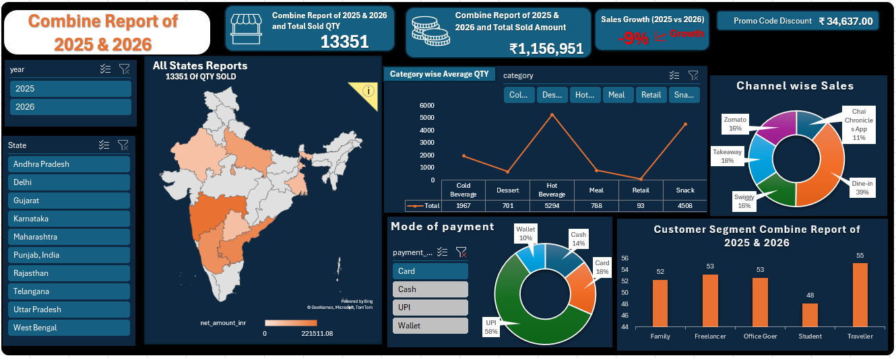

::: {align="center"}
# 📊 Sales Analytics Dashboard \| 2025 & 2026

### Interactive Sales Performance & Business Insights in Microsoft Excel

**Sales KPIs • Geographic Analysis • Customer Segments • Payment
Insights • Interactive Filters**


:::

------------------------------------------------------------------------

## 📌 Project Overview

This project presents an interactive **Sales Analytics Dashboard**
designed in Microsoft Excel to explore combined sales performance for
**2025 and 2026**.

The dashboard brings together high-level sales indicators, state-wise
geographic performance, product category insights, sales channels,
payment methods, and customer segments in a single visual report.
Interactive slicers help users explore different portions of the data
without manually editing the underlying report.

> **Note:** The figures below are taken from the provided dashboard
> screenshot and represent the view shown there. They may change when
> filters are applied. The underlying dataset and workbook have not been
> independently audited.

## 🖼️ Dashboard Preview

Add your dashboard screenshot to the repository at
`assets/dashboard-preview.png` to display it here:



## 📈 Dashboard Snapshot

  Metric                              Value shown in dashboard
  --------------------------------- --------------------------
  **Total Units Sold**                              **13,351**
  **Total Sales Amount**                        **₹1,156,951**
  **Sales Growth (2025 vs 2026)**                      **-9%**
  **Promo Code Discount**                       **₹34,637.00**

**Growth indicator:** The dashboard displays negative growth in red to
make the decline immediately visible. The growth percentage should be
validated against the same reporting periods and filter context before
being used for business decisions.

## 🎯 Project Objectives

-   Consolidate the sales reporting view across **2025 and 2026**.
-   Monitor total units sold, sales amount, discounts, and
    year-over-year growth.
-   Explore sales performance across Indian states.
-   Compare sales channels and payment preferences.
-   Examine category-level average quantities and customer segments.
-   Make the report easier to navigate with interactive slicers.

## 🧩 Dashboard Components

### 1. KPI Summary Cards

A top-level view of **Total Units Sold**, **Total Sales Amount**,
**Sales Growth**, and **Promo Code Discount**. The sales growth card
uses conditional color cues to distinguish negative and positive
results.

### 2. State-wise Sales Map 🗺️

An India map displays the geographic distribution of the selected sales
measure. It supports quick visual comparison across states included in
the report.

### 3. Category-wise Average Quantity 📦

A category chart compares average quantities across the displayed
product categories, including **Cold Beverage, Dessert, Hot Beverage,
Meal, Retail, and Snack**.

### 4. Channel-wise Sales 🛒

A doughnut chart breaks down sales by channels shown in the dashboard,
including **Dine-in, Takeaway, Zomato, Swiggy, and other channels**.

### 5. Mode of Payment 💳

A doughnut chart visualizes payment-method distribution across **Card,
Cash, UPI, and Wallet**.

### 6. Customer Segment Analysis 👥

A column chart compares the displayed customer segment metric across
**Family, Freelancer, Office Goer, Student, and Traveller**.

> **Metric note:** The customer segment chart's underlying aggregation
> is not specified in the screenshot, so its values should not be
> interpreted as revenue or customer counts without checking the
> PivotTable.

## 🎛️ Interactive Filters

The screenshot shows slicers for:

  Filter               Purpose
  -------------------- -------------------------------------
  **Year**             Explore 2025 and 2026
  **State**            Focus on a selected Indian state
  **Category**         Compare selected product categories
  **Payment Method**   Focus on Card, Cash, UPI, or Wallet

The dashboard also uses a consistent dark-themed layout with orange and
blue chart accents.

## 🛠️ Tools & Techniques

  -----------------------------------------------------------------------
  Tool / Technique                    Role
  ----------------------------------- -----------------------------------
  **Microsoft Excel**                 Dashboard creation and presentation

  **PivotTables & PivotCharts**       Aggregated analysis and charting

  **Slicers**                         Interactive filtering

  **Map Visualization**               Geographic performance display

  **Excel Charts**                    Category, channel, payment, and
                                      segment analysis

  **VBA (optional)**                  Dynamic KPI or shape formatting
                                      where implemented
  -----------------------------------------------------------------------

**Important:** The screenshot confirms the dashboard's visual elements,
but does not by itself verify the workbook's formulas, VBA
implementation, refresh process, or source data quality.

## 📂 Suggested Repository Structure

``` text
Sales-Analytics-Dashboard/
│
├── README.md
├── assets/
│   └── dashboard-preview.png
│
└── dashboard/
    └── Sales_Analytics_Dashboard.xlsx
```

Rename the workbook entry to match the actual uploaded file. If the
workbook uses VBA macros, keep it in **`.xlsm`** format instead of
`.xlsx`.

## 🚀 How to Use

1.  Clone or download this repository.
2.  Open the dashboard workbook in **Microsoft Excel Desktop**.
3.  If Excel displays **Protected View**, enable editing only if you
    trust the file.
4.  If the workbook contains macros, review the VBA before enabling
    macros.
5.  Use the **Year, State, Category, and Payment Method** slicers to
    explore the report.
6.  Review KPI cards and charts as you change filters.
7.  If the workbook includes an external data source, update its
    connections before refreshing.

## 💡 Key Analytical Questions

This dashboard can help investigate questions such as:

-   How does sales performance compare between **2025 and 2026**?
-   Which states contribute more to the selected sales measure?
-   Which product categories show higher average quantities?
-   Which sales channels account for larger sales shares?
-   Which payment methods are most represented?
-   How does the displayed metric vary across customer segments?

These are **questions supported by the dashboard's design**, not
conclusions established from a full audit of the data.

## 🔮 Potential Enhancements

-   Add a **Monthly Sales Trend** with a 2025-versus-2026 comparison.
-   Add a **Top 5 / Bottom 5 States** ranking.
-   Include explicit KPI definitions and year-over-year growth
    methodology.
-   Add a **Last Refreshed** timestamp and data validation checks.
-   Improve small chart labels and mobile-size readability of
    screenshots.

## 👨‍💻 Author

**Rohit**

GitHub: [@heyrohhit](https://github.com/heyrohhit)

*Excel Dashboard Development • Data Analysis • Data Visualization*

------------------------------------------------------------------------

::: {align="center"}
**⭐ If you find this project useful, consider starring the
repository.**

*Built with Microsoft Excel for interactive sales reporting and visual
analysis.*
:::
